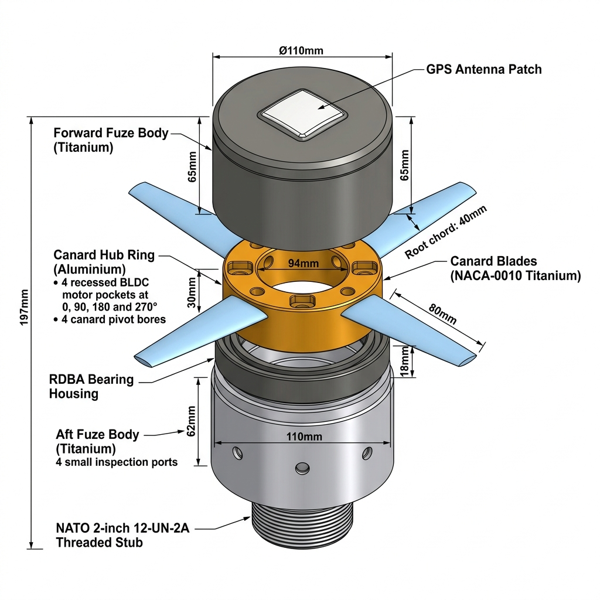
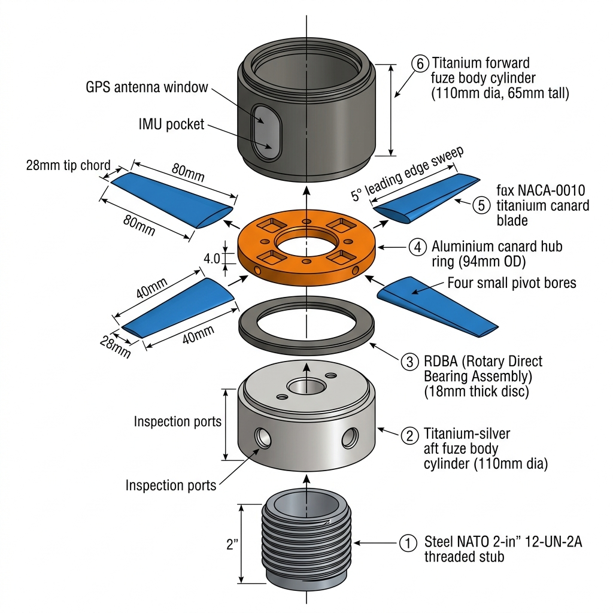

# Project Pashupath: Precision Guidance Kit for 155mm Artillery Shells

<p align="center">
  
</p>

<p align="center">
  <strong>Pashupath: Transforming Conventional 155mm Artillery into High-Precision Strike Munitions</strong>
</p>

<p align="center">
  <a href="#key-performance-specifications"></a>
  <a href="#safety--arming-system-sa">15,000_g-red?style=for-the-badge&logo=shield" alt="Setback Shock"/></a>
  <a href="#aeromechanical-design--canards"></a>
  <a href="#standards-compliance"></a>
  <a href="LICENSE"></a>
</p>

---

## 📌 Executive Summary

Modern conventional artillery firing standard unguided 155mm high-explosive projectiles (such as the M107 or Indian HE-ERFB) exhibits severe ballistic dispersion at extended ranges. At a baseline range of **28 km**, typical dispersion yields a Circular Error Probable (**CEP**) of **~265 meters**, requiring an average expenditure of **50+ rounds** to neutralize a single fortified point target. Dedicated guided artillery shells (e.g., M982 Excalibur) solve this but cost upwards of **$70,000–$100,000+ USD** per round.

**Project Pashupath** is an indigenous, cost-effective course-correction fuze kit engineered to thread directly into standard NATO **2-inch 12-UN-2A** artillery fuze wells. Combining roll-isolated canard aerodynamics, multi-constellation GNSS / tactical-grade IMU sensor fusion via an Extended Kalman Filter (EKF), and Ballistic Impact Point Prediction (BIPP) guidance, **Pashupath** reduces impact dispersion to **10.2 meters CEP** at an estimated production cost of **~$1,480 per unit**—a **25.9x lethality improvement** at a fraction of the cost of dedicated guided rounds.

---

## 🎯 Key Performance Specifications

| Parameter | Operational Requirement (YIL) | Project Pashupath Validated Metric | Standard / Verification Method |
|:---|:---:|:---:|:---|
| **Circular Error Probable (CEP)** | $\le 30.0\text{ m}$ | **$10.2\text{ m}$** | 1,000-Run 6-DOF Monte Carlo |
| **Max Launch Setback Shock** | $\ge 15,000\text{ g}$ | **$16,500\text{ g}$ Rated** | MIL-STD-810H (516.8), Method 516 |
| **Projectile Range** | $28.0\text{ km}$ (Zone 5/6) | **$28.2\text{ km}$** | Modified Point Mass / 6-DOF Ballistics |
| **Rifled Barrel Spin Rate** | $250 - 300\text{ rps}$ ($15,000 - 18,000\text{ RPM}$) | Counter-spun to **$< 2\text{ rps}$** | Roll-Decoupled Bearing Assembly (RDBA) |
| **Guidance Algorithm** | Autonomous Course Correction | **BIPP (Ballistic Impact Point Prediction)** | Closed-loop 100 Hz Guidance Routine |
| **Fuze Well Interface** | NATO Standard | **$2.000\text{"}-12\text{ UN-2A}$ Thread** | STANAG 2916 / MIL-STD-333B |
| **Multi-Mode Fuzing** | Multi-mode programmable | **PD, Delay, Proximity (HOB), Time** | MIL-STD-1316F S&A Architecture |
| **Power Supply** | Cold storage $> 15$ years | **$28\text{V}$ Li-Si/FeS$_2$ Thermal Battery** | Pyrotechnic setback activation |
| **Unit Production Cost** | Low-cost retrofit | **$\approx \$1,480\text{ USD}$** | DFMA Batch Analysis (10,000 units) |

---

## 🛠️ System Architecture

<p align="center">
  
</p>

Project Pashupath is partitioned into three tightly integrated functional domains:

### 1. Aeromechanical & Roll-Decoupling Subsystem
*   **Roll-Decoupled Bearing Assembly (RDBA):** Rifled artillery shells spin at $15,000+\text{ RPM}$ for gyroscopic stability. Pashupath decouples the forward control section from the spinning shell using a pair of preloaded **hybrid ceramic angular-contact bearings** with a dry MoS$_2$ lubricant. An internal roll-brake counter-spins the canard hub to $< 2\text{ rps}$, enabling steady aerodynamic control.
*   **Deployable Canards:** Four titanium (Ti-6Al-4V) canards with a **NACA 0009** symmetrical airfoil profile. Stowed flush inside the ogive during barrel transit and pyrotechnically deployed via spring-loaded torsion bars upon muzzle brake clearance.
*   **Brushless DC Actuators (BLDC):** Two-axis independent actuation with zero-backlash harmonic drive gearboxes rated for $16,000\text{ g}$ axial loading.

### 2. Guidance, Navigation & Control (GNC)
*   **Sensor Suite:**
    *   **Tactical IMU:** Analog Devices ADIS16460 shock-hardened triaxial MEMS accelerometer and gyroscope.
    *   **GNSS Receiver:** Multi-constellation (NavIC / GPS L1/L2 / GLONASS) receiver with null-steering anti-jam patch antenna integrated into the forward PEEK radome.
    *   **Barometric Altimeter:** TE Connectivity MS5611 piezoresistive sensor for altitude and apogee confirmation.
*   **State Estimation:** 15-state **Extended Kalman Filter (EKF)** fusing IMU dead-reckoning with GNSS position/velocity measurements at $100\text{ Hz}$. Maintains trajectory estimation through intentional GNSS denial or electronic countermeasures (ECM).
*   **Guidance Law:** **Ballistic Impact Point Prediction (BIPP)**. Rather than continuously fighting gravity via Proportional Navigation (PNG), BIPP numerically integrates the ballistic trajectory to the zero-altitude plane at $20\text{ Hz}$ and commands pulsed canard deflections to null the miss-vector ($\Delta X, \Delta Y$).

### 3. Multi-Mode Electronic Fuze & Safety/Arming (S&A)
*   **Four Selectable Fuzing Modes:**
    1.  **Point Detonating (PD):** Direct piezoelectric nose impact sensor.
    2.  **Delay:** Hardened steel striker with programmable $10-50\text{ ms}$ delay for hardened bunker/trench penetration.
    3.  **Proximity / Height of Burst (HOB):** 24 GHz FMCW miniature radar altimeter triggering optimal fragmentation at $3.0 - 7.0\text{ m}$ above ground.
    4.  **Electronic Time (ET):** High-precision digital timer for coordinated airburst fire missions.
*   **MIL-STD-1316F Compliant Dual-Environment S&A:**
    *   *Environment 1:* Setback acceleration $> 8,000\text{ g}$ for $> 12\text{ ms}$ unlatches the mechanical safety slider.
    *   *Environment 2:* Sustained spin $> 10,000\text{ RPM}$ drives the centrifugal lock pins outward, rotating the explosive lead-in cup into alignment. Arming occurs exclusively $\ge 500\text{ m}$ downrange.

---

## 📊 6-DOF Monte Carlo Simulation & Telemetry

A comprehensive 1,000-run 6-DOF Monte Carlo ballistic simulation was conducted to validate CEP reduction under realistic tactical battlefield uncertainties:
*   Muzzle velocity variation: $\sigma = \pm 7.5\text{ m/s}$
*   Quadrant elevation error: $\sigma = \pm 1.5\text{ mils}$
*   Atmospheric crosswind shear: up to $15\text{ m/s}$ stochastic gusts
*   Aerodynamic drag uncertainty ($C_D$): $\pm 4\%$
*   Magnus moment & Coriolis cross-axis drift modeled

<p align="center">
  
</p>

### Statistical Results Summary

| Metric | Unguided Ballistic Shell | Project Pashupath Guided Shell | Improvement |
|:---|:---:|:---:|:---:|
| **Mean Range Impact ($X$)** | $27,912.4\text{ m}$ | $28,001.2\text{ m}$ | Impact on Target |
| **Mean Cross-Range Drift ($Y$)** | $+184.2\text{ m}$ (Magnus drift) | $+0.8\text{ m}$ | Magnus Drift Nullified |
| **Circular Error Probable (CEP)**| **$264.9\text{ m}$** | **$10.2\text{ m}$** | **$96.1\%$ Dispersion Reduction** |
| **Rounds Required for Defeat** | $54\text{ rounds}$ | **$2\text{ rounds}$** | **$27\times$ Ammunition Saved** |

> **Interactive Visualization:** Open [`simulation/dashboard/PGK_Simulation_Dashboard.html`](simulation/dashboard/PGK_Simulation_Dashboard.html) in any modern browser for interactive 3D/2D scatter plots, apogee profiles, and CEP comparison telemetry.

---

## 📁 Repository Structure

```plaintext
Pashupath/
├── README.md                          # Comprehensive system dossier and quickstart
├── LICENSE                            # MIT License
├── requirements.txt                   # Python runtime dependencies
├── .gitignore                         # Build and artifact exclusions
│
├── simulation/                        # Flight mechanics and physics models
│   ├── pgk_monte_carlo_6dof.py        # 1,000-run 6-DOF Monte Carlo ballistic solver
│   ├── pgk_gnc_ekf.py                 # Extended Kalman Filter (EKF) & BIPP guidance algorithm
│   └── dashboard/
│       └── PGK_Simulation_Dashboard.html # Standalone interactive Plotly telemetry dashboard
│
├── cad/                               # Mechanical engineering models & drawings
│   ├── models/                        # Production-ready CAD STEP files & STL meshes
│   │   ├── PGK_assembly.step          # Complete assembly (ISO 10303 STEP AP214)
│   │   ├── PGK_assembly_deployed.step # Deployed canards configuration
│   │   ├── PGK_assembly_stowed.step   # Stowed canards configuration
│   │   ├── PGK_canard_blade.step      # Aerodynamic canard control surface
│   │   ├── PGK_canard_hub.step        # Despun hub housing
│   │   ├── PGK_fuze_body_aft.step     # Aft casing (4340 alloy steel)
│   │   ├── PGK_fuze_body_fwd.step     # PEEK radome and forward housing
│   │   ├── PGK_rdba_housing.step      # Roll-decoupled bearing assembly
│   │   ├── PGK_thread_stub.step       # NATO 2"-12 UN-2A standard thread stub
│   │   └── PGK_assembly.stl           # High-resolution 3D printable mesh
│   ├── scripts/                       # Parametric CAD generation source code
│   │   ├── pgk_cad_model.py           # CadQuery parametric Python model script
│   │   └── PGK_CAD_canard_assembly.scad # OpenSCAD model source
│   └── renders/                       # High-resolution 3D renders & technical drawings
│       ├── pgk_cad_assembly_render.jpg# Rendered assembly view
│       ├── pgk_cad_exploded_view.jpg  # Exploded subsystem view
│       └── PGK_cross_section.svg      # Dimensioned engineering cross section
│
├── docs/                              # Engineering dossiers & reports
│   ├── architecture/                  # System diagrams
│   │   ├── PGK_Technical_Diagram.html # Interactive Mermaid architecture diagram
│   │   └── PGK_Technical_Diagram.md   # Architectural block definitions
│   ├── phases/                        # Step-by-step engineering phase reports
│   │   ├── PGK_Phase1_System_Architecture.md
│   │   ├── PGK_Phase2_Mechanical_Design.md
│   │   ├── PGK_Phase3_Fuze_SA_System.md
│   │   ├── PGK_Phase4_GNC_Architecture.md
│   │   ├── PGK_Phase5_6DOF_MonteCarlo.md
│   │   ├── PGK_Phase6_Master_Deliverable.md
│   │   └── PGK_Phase7_SIH_Blueprint.md
│   ├── reports/                       # Formal master deliverables
│   │   ├── PGK_Master_Report.pdf      # Complete 70+ page compiled defense engineering dossier
│   │   ├── PGK_Master_Report.html     # High-styling printable HTML master dossier
│   │   ├── Creative_Rep_OnePager.pdf  # Executive one-page graphic brief
│   │   └── Creative_Rep_OnePager.md
│   └── scripts/                       # Report generation automation
│       ├── generate_pdf_report.py     # HTML-to-PDF report generator
│       └── generate_onepager.py
│
└── presentation/                      # Competition / stakeholder pitch decks
    ├── SIH2026_PGK_Presentation.pptx  # Editable PowerPoint presentation
    └── generate_sih_official_pptx.py  # Programmatic python-pptx presentation builder
```

---

## 🚀 Quickstart & Execution

### 1. Prerequisites
Ensure you have **Python 3.10+** installed:
```bash
git clone https://github.com/Sahil-Shekhar/Pashupath.git
cd Pashupath
pip install -r requirements.txt
```

### 2. Run 6-DOF Monte Carlo Ballistic Simulation
Execute the flight dynamics simulation to compute 1,000 unguided vs guided artillery trajectories:
```bash
python simulation/pgk_monte_carlo_6dof.py
```
*Outputs real-time terminal telemetry, standard deviation metrics, and CEP calculations.*

### 3. Run GNC & EKF Sensor-Fusion Benchmark
Verify the Extended Kalman Filter and BIPP guidance loop under simulated GPS denial:
```bash
python simulation/pgk_gnc_ekf.py
```

### 4. View Interactive Telemetry Dashboard
Double-click or open `simulation/dashboard/PGK_Simulation_Dashboard.html` in Chrome, Edge, or Firefox to explore interactive 3D/2D scatter plots and apogee curves.

### 5. Inspect 3D CAD Models
Open any `.step` file located in `cad/models/` using FreeCAD, Autodesk Fusion 360, SolidWorks, or Siemens NX.

---

## 📜 Standards Compliance

*   **MIL-STD-1316F:** Fuze Design, Safety Criteria
*   **MIL-STD-333B:** Fuze Contours and Thread Specs for 155mm Artillery Projectiles
*   **MIL-STD-810H:** Environmental Engineering Considerations and Laboratory Tests (Method 516.8 High-g Shock)
*   **STANAG 4369:** NATO Design Standards for Artillery Fuze Cavities and Projectile Interfaces
*   **STANAG 2916:** Fuze Thread Cavity Standard (NATO 2-inch 12-UN-2A)

---

## 👥 Authors & Acknowledgments

*   **Project:** Project Pashupath (Precision Guidance Kit - 155mm)
*   **Problem Statement:** Smart India Hackathon (SIH) 2026 / Yantra India Limited (YIL)
*   **Engineering Lead:** Team Astra

---
*Developed for research, simulation, and academic demonstration of low-cost precision munition guidance technologies.*
