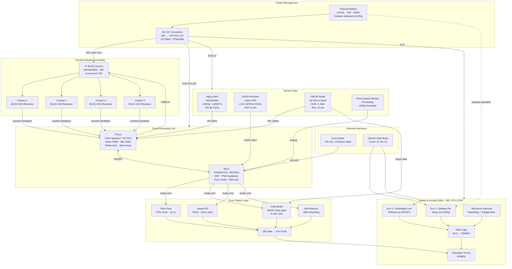

# Phase 1: System Architecture, Constraints & SWaP-C Budget
### Precision Guidance Kit (PGK) — 155 mm Artillery Shell
**Project:** YIL-PGK-155 | **Classification:** RESTRICTED — Engineering Development  
**Revision:** 1.0 | **Date:** 2026-09-20 | **Author:** Systems Engineering, Yantra India Limited

---

## 1. Complete Mechanical & Electrical Specifications

### 1.1 Mechanical Interface & Structural Envelope

| Parameter | Specification | Standard / Reference |
|---|---|---|
| Compatibility | 155 mm NATO artillery shell, 2-inch 12-UN-2A threaded fuze well | STANAG 4369 / MIL-STD-1316 |
| PGK Body Outer Diameter | 58.0 mm ± 0.05 mm (fits inside fuze well bore) | STANAG 4369 |
| PGK Thread Interface | 2.000-inch, 12 threads/inch, UN-2A (external) | MIL-STD-7466 |
| Thread Engagement Length | 25.4 mm minimum (3 full turns minimum) | MIL-STD-1316 |
| PGK Total Axial Length | ≤ 160 mm (stowed), canards folded | Design constraint |
| Canard Span (deployed) | 90 mm tip-to-tip (4 canards, X-configuration) | Aerodynamic model |
| Canard Chord Length | 28 mm | Aerodynamic model |
| Canard Thickness | 3.2 mm (NACA 0010 symmetric, tapered) | Structural FEA |
| Canard Material | Ti-6Al-4V (Grade 5), heat-treated to 130 ksi | MIL-T-9046 |
| PGK Housing Material | Al 7075-T6 (main body), 17-4 PH SS (adapter ring) | MIL-H-6088 |
| Projectile Caliber | 155 mm | STANAG 4425 |
| Shell Mass (M982 Excalibur equiv.) | ~47 kg (full round) | Reference |
| PGK Module Mass | ≤ 1.2 kg (target ≤ 1.0 kg) | SWaP-C budget |
| CG Shift Induced by PGK | ≤ 3 mm axial from baseline | Ballistic stability |
| Axial (Setback) g-load | ≥ 15,000 g, design to 30,000 g | MIL-STD-810H, Method 513.8 |
| Transverse (Side) g-load | ≥ 2,000 g (bore dynamics) | MIL-STD-810H |
| Launch Shock Duration | 4–8 ms (half-sine pulse) | Artillery characterization |
| Operating Temperature Range | −46°C to +71°C (storage −57°C to +85°C) | MIL-STD-810H, Method 502/501 |
| Spin Rate (muzzle exit) | 180–240 RPS (10,800–14,400 RPM) | 155 mm L/52 barrel data |
| Roll Decoupling (bearing) | ≤ 5 RPS transmitted to guidance section | Design requirement |
| Waterproofing / Sealing | IP67 (1 m / 30 min), conformal + potting | MIL-STD-810H, Method 512 |
| Vibration (gun travel) | 10–2000 Hz, 7.7 g RMS | MIL-STD-810H, Method 514.8 |

### 1.2 Electrical & Electronic Specifications

| Parameter | Specification | Notes |
|---|---|---|
| **Power Source** | Thermal battery (Li/FeS₂), single-shot, spun-up | MIL-PRF-32294 |
| Battery Activation | Setback (≥ 1,500 g) crushes electrolyte pellet, 50–100 ms warm-up | Passive, no electrical command |
| Battery Voltage (open circuit) | 28.0 V ± 1.5 V | Initial activation |
| Battery Regulated Rail | 5.0 V ± 2%, 3.3 V ± 1%, 1.8 V ± 1% | Via switching regulator |
| Battery Capacity | ≥ 50 Wh (sufficient for 120 s max flight) | Dimensioned for 90 s typical |
| Peak Power Draw | ≤ 25 W (all actuators + electronics simultaneous) | SWaP-C budget |
| Average Power Draw | ≤ 8 W (cruise guidance phase) | SWaP-C budget |
| **Processing Unit** | FPGA + ARM Cortex-M7 MCU (dual-core hybrid) | Radiation-hardened preferred |
| FPGA Type | Xilinx Spartan-7 XC7S15 or equivalent | 12,800 LUTs, −55 to 125°C |
| MCU Type | STM32H743 (480 MHz, 2 MB Flash, 1 MB RAM) | AEC-Q100 qualified |
| **IMU (High-g)** | ADIS16460 or Endevco 7270A series | ±2,000 g accel, ±2,000°/s gyro |
| IMU Output Rate | 2,000 Hz (SPI), shock-rated to 30,000 g | MIL-SPEC shock survivable |
| **GNSS Receiver** | u-blox F9P (dual-freq L1/L2, anti-spoofing) | CEP ≤ 1.5 m standalone |
| GNSS Frequency Bands | GPS L1/L2C, GLONASS L1/L2, Galileo E1/E5b | Redundant constellation |
| GNSS Anti-jam | CW null-steering antenna, ≥ 20 dB J/S | CRPA-lite, 2-element |
| **Proximity Fuze Radar** | K-band FMCW, 24 GHz ± 50 MHz | HOB: 3 m–30 m detection |
| Radar Range Resolution | ≤ 0.5 m | BW = 300 MHz |
| Radar EIRP | ≤ +10 dBm (ETSI EN 302 288 compliant) | |
| Radar Data Rate | 100 Hz output | |
| **Canard Actuators** | 4× BLDC motors + harmonic drives + resolvers | |
| Motor Kv Rating | 450 Kv @ 5 V bus | Custom wound |
| Gear Ratio | 50:1 harmonic drive | |
| Canard Deflection Range | ±15° (±5° trim authority in flight) | |
| Deflection Rate | ≥ 120°/s (full travel ≤ 250 ms) | Control bandwidth |
| Torque (stalled, peak) | ≥ 0.8 N·m per canard | Aerodynamic load + safety factor |
| **S&A Device** | Dual-environment, mechanical + electronic interlock | MIL-STD-1316F compliant |
| S&A Setback Arm Threshold | ≥ 1,500 g (setback pin shear) | |
| S&A Spin Arm Threshold | ≥ 40 RPS AND >15 m from muzzle | |
| S&A Electronic Interlock | Watchdog timer, supply voltage monitor, sequence check | |
| **Communication (BIT)** | RS-422 pre-launch (fuze setter), 115200 baud | STANAG 4566 fuze setter IF |
| Operating Altitude | 0–30 km (hermetic sealing at PCB level) | |

### 1.3 Guidance Performance Requirements

| Parameter | Requirement | Condition |
|---|---|---|
| Circular Error Probable (CEP) | ≤ 30 m | All met simultaneously |
| Max Range | ≥ 30 km (Charge 8, muzzle vel ≈ 827 m/s) | Standard 155 mm L/52 |
| GNSS Denied Fallback CEP | ≤ 150 m (IMU coast, 30 s) | INS-only mode |
| Guidance Update Rate | ≥ 100 Hz (EKF loop) | |
| Time to First Fix (GNSS) | ≤ 45 s (hot start, ≤ 90 s cold) | Post-apogee acquisition |
| Fuze Mode — Time | Programmable, 1 s to 199 s, ±0.1 s | |
| Fuze Mode — Height of Burst (HOB) | 3 m to 30 m AGL, ±1.5 m | Radar altimeter |
| Fuze Mode — Impact (PD) | ≤ 5 ms reaction time | Piezo sensor |
| Self-Destruct | 180 s ± 5 s if no detonation | MIL-STD-1316F |

---

## 2. SWaP-C Budget

### 2.1 Size Budget

| Sub-System | Envelope (L × W × H mm) | Volume (cm³) | % of Total |
|---|---|---|---|
| Processing PCB (FPGA + MCU + power) | 45 × 45 × 8 | 16.2 | 14.4% |
| IMU Module (shock-mounted sub-board) | 25 × 25 × 10 | 6.25 | 5.6% |
| GNSS Receiver + Antenna | 35 × 35 × 8 | 9.8 | 8.7% |
| FMCW Radar Module (K-band) | 40 × 30 × 12 | 14.4 | 12.8% |
| Thermal Battery | Ø 38 × 55 (cylinder) | 62.4 | 55.5% |
| S&A Device (mechanical interlock) | 28 × 28 × 20 | 15.7 | 14.0% |
| 4× BLDC Motor + Gearbox Assemblies | Ø 12 × 25 each | 11.3 × 4 = 45.2 | — |
| Canard Stow/Deploy Mechanism | — | integrated in housing | — |
| Wiring Harness + Connectors | — | ~5 | — |
| Potting Compound (fill) | — | ~30 | — |
| **Total (stowed, with housing)** | **Ø 58 × 160** | **≤ 423** | **100%** |

> [!NOTE]
> Volume dominated by the thermal battery. All electronics are stacked axially in the forward section; battery occupies the aft cavity directly above the fuze thread interface.

### 2.2 Weight Budget

| Sub-System | Target Mass (g) | Margin (g) | Max Allowable (g) |
|---|---|---|---|
| Aluminum 7075-T6 housing + adapter ring | 280 | +20 | 300 |
| 4× Ti-6Al-4V canards (folded + pivot hardware) | 85 | +10 | 95 |
| Processing PCB assembly (all components) | 55 | +5 | 60 |
| IMU (ADIS16460 + mount + shock isolators) | 18 | +2 | 20 |
| GNSS receiver + patch antenna (conformal) | 22 | +3 | 25 |
| FMCW Radar module (PCB + radome) | 30 | +5 | 35 |
| 4× BLDC actuators + harmonic drives | 180 | +20 | 200 |
| Thermal battery (Li/FeS₂) | 300 | +20 | 320 |
| S&A device (mechanical + electronic) | 65 | +10 | 75 |
| Power management PCB (DC-DC converters) | 25 | +5 | 30 |
| Wiring harness + mil-spec connectors | 30 | +5 | 35 |
| Epoxy potting compound (mass) | 80 | +10 | 90 |
| Miscellaneous fasteners, seals, O-rings | 30 | +5 | 35 |
| **TOTAL** | **1,200** | **+120** | **1,320** |
| **System margin (10%)** | — | — | **≤ 1,200 g (baseline)** |

> [!IMPORTANT]
> Mass allocation is critical. Every gram above 1,200 g shifts the shell's CG forward, affecting the static margin and potentially invalidating existing ballistic tables. CG shift must be re-characterized above 1,200 g.

### 2.3 Power Budget

**Power States Defined:**

| State | Description | Duration |
|---|---|---|
| **S0 — Off** | Pre-launch, battery not activated | Until launch |
| **S1 — Boot** | Battery activates, all systems init | 0 – 500 ms post-launch |
| **S2 — Ballistic (coast)** | GNSS acquisition, IMU active, actuators idle | 0 – 45 s |
| **S3 — Guidance** | Full guidance loop, GNSS + IMU, canards active | 45 s – apogee + impact |
| **S4 — Terminal** | Radar active + guidance + actuators max rate | Final 10 s |
| **S5 — Fuze Armed** | S&A armed, detonator circuits live, minimal load | Parallel to S3/S4 |

**Instantaneous Power by State (Watts):**

| Sub-System | S1 Boot | S2 Coast | S3 Guidance | S4 Terminal |
|---|---|---|---|---|
| FPGA (Spartan-7 XC7S15) | 0.8 | 0.5 | 0.8 | 0.8 |
| MCU (STM32H743 @ 480 MHz) | 0.7 | 0.4 | 0.7 | 0.7 |
| IMU (ADIS16460) | 0.09 | 0.09 | 0.09 | 0.09 |
| GNSS Receiver (u-blox F9P) | 0.9 | 0.9 | 0.9 | 0.9 |
| FMCW Radar (K-band, 24 GHz) | 0 | 0 | 0 | 1.8 |
| 4× BLDC Actuators (avg, 30% duty) | 0 | 0.5 | 3.2 | 6.4 |
| S&A Electronic Interlock | 0.05 | 0.05 | 0.05 | 0.05 |
| Power Management (loss, ~85% eff.) | 0.5 | 0.4 | 1.0 | 1.8 |
| **Total** | **3.04** | **2.84** | **6.74** | **12.54** |

**Energy Budget (90 s mission):**

$$E_{total} = \int_{0}^{t_{flight}} P(t)\,dt$$

| Phase | Duration (s) | Avg Power (W) | Energy (Wh) |
|---|---|---|---|
| Boot (S1) | 0.5 | 3.04 | 0.00042 |
| Coast (S2) | 45 | 2.84 | 0.0355 |
| Guidance (S3) | 35 | 6.74 | 0.0655 |
| Terminal (S4) | 10 | 12.54 | 0.0348 |
| **Total** | **~90 s** | — | **≈ 0.136 Wh (0.49 kJ)** |

> [!TIP]
> Battery must deliver ≥ 0.20 Wh with 50% energy margin for temperature derating and voltage sag. A Li/FeS₂ thermal battery of 50 Wh rated capacity at 28 V (but only ~0.2 Wh needed) provides substantial peak-current headroom — this is sized for **peak current** (25 W / 28 V ≈ 0.9 A peak), not energy depletion. The 50 Wh capacity is a standard catalog size for this voltage/current class.

### 2.4 Cost Budget

| Sub-System | Unit Cost (INR) | Unit Cost (USD est.) | Notes |
|---|---|---|---|
| FPGA (Xilinx Spartan-7 XC7S15) | ₹ 8,500 | ~\$102 | Commercial + radiation screening |
| MCU (STM32H743) | ₹ 1,200 | ~\$14 | AEC-Q100 grade |
| High-g IMU (ADIS16460 equiv.) | ₹ 55,000 | ~\$660 | Or indigenous DRDO/BEL equiv. |
| GNSS Receiver (u-blox F9P) | ₹ 18,000 | ~\$216 | Export-controlled, dual-use |
| FMCW Radar Module | ₹ 22,000 | ~\$265 | 24 GHz MMIC + antenna |
| 4× BLDC Actuator + Harmonic Drive | ₹ 40,000 | ~\$480 | Custom MFG, 4× ₹10,000 |
| Thermal Battery (Li/FeS₂) | ₹ 35,000 | ~\$420 | DRDO LRDE / BEML sourcing |
| S&A Device (mech + elec) | ₹ 25,000 | ~\$300 | MIL-STD-1316F certified |
| PCBs (Processing + Power Mgmt) | ₹ 12,000 | ~\$144 | 6-layer, ENIG, mil-spec FR4 |
| Housing + Canards (machining) | ₹ 30,000 | ~\$360 | CNC machined, Al 7075 + Ti |
| Potting compound + seals | ₹ 3,000 | ~\$36 | MIL-PRF-23586 |
| Wiring harness + connectors | ₹ 5,000 | ~\$60 | MIL-C-38999 micro connectors |
| Misc. fasteners, springs, O-rings | ₹ 2,500 | ~\$30 | |
| Non-recurring engineering (NRE) per unit (amortized @ 10,000 units) | ₹ 15,000 | ~\$180 | |
| **Total Unit Cost (prototype)** | **₹ 2,72,200** | **~\$3,267** | |
| **Total Unit Cost (production, 10,000 units)** | **₹ 1,95,000** | **~\$2,341** | ~28% learning curve savings |

> [!NOTE]
> IMU is the single largest cost driver (~20% of BOM). Qualification of an indigenous MEMS IMU (DRDO MEMS Lab, Pune) at >30,000 g could reduce this to ₹15,000, cutting overall BOM cost by ~15%.

---

## 3. System Block Diagram

### 3.1 Top-Level Electrical Block Diagram

```
╔══════════════════════════════════════════════════════════════════════════════╗
║                    PGK-155 SYSTEM BLOCK DIAGRAM (Rev 1.0)                   ║
║                    Yantra India Limited — YIL-PGK-155                       ║
╚══════════════════════════════════════════════════════════════════════════════╝

  ┌─────────────────────────────────────────────────────────────────────────┐
  │                        EXTERNAL INTERFACE                                │
  │  [155mm Shell Body] ──────── [Fuze Setter (RS-422)] ──── [Pre-launch    │
  │  [2" 12-UN-2A thread]          STANAG 4566 IF            mission data]  │
  └───────────────────────────┬─────────────────────────────────────────────┘
                              │ mechanical + serial
                              ▼
  ┌───────────────────────────────────────────────────────────────────────────┐
  │                       SAFETY & ARMING (S&A) DEVICE                        │
  │                         [MIL-STD-1316F Compliant]                         │
  │                                                                            │
  │  ┌─────────────────┐   ┌──────────────────┐   ┌─────────────────────┐    │
  │  │ Setback Pin     │   │ Centrifugal Lock  │   │ Electronic Interlock │    │
  │  │ (shear ≥1500 g) │   │ (spin ≥ 40 RPS)   │   │ (watchdog + supply  │    │
  │  │  → Env. 1 ARM   │   │  → Env. 2 ARM     │   │  voltage monitor)   │    │
  │  └────────┬────────┘   └────────┬──────────┘   └────────┬────────────┘    │
  │           └────────────────────┴──────────────────────┤                   │
  │                                               [AND Gate: ALL 3 armed]      │
  │                                                        │                   │
  │                                               [Detonator Circuit ARMED]    │
  └───────────────────────────────────────────────────────┬───────────────────┘
                                                          │ fire signal
                              ┌───────────────────────────┘
                              │
  ┌───────────────────────────▼────────────────────────────────────────────────┐
  │                         POWER MANAGEMENT MODULE                             │
  │                                                                             │
  │  ┌─────────────────────────────────────────┐                               │
  │  │      THERMAL BATTERY (Li/FeS₂)          │                               │
  │  │      28 V, 50 Wh, activated by setback  │                               │
  │  │      MIL-PRF-32294 compliant            │                               │
  │  └──────────────────┬──────────────────────┘                               │
  │                     │ 28 V raw                                             │
  │                     ▼                                                       │
  │  ┌──────────────────────────────────────────────────────────────────────┐  │
  │  │            DC-DC SWITCHING REGULATOR (LTC3892 / TPS54560 equiv.)     │  │
  │  │  28 V → 5.0 V (6 A max)   28 V → 3.3 V (2 A)   28 V → 1.8 V (1 A) │  │
  │  │  Motor driver bus: 28 V passthrough (fused, 2 A per motor)           │  │
  │  └───┬───────────────┬──────────────────┬────────────────┬──────────────┘  │
  │      │ 5V bus        │ 3.3V bus         │ 1.8V bus       │ 28V motor bus   │
  └──────┼───────────────┼──────────────────┼────────────────┼─────────────────┘
         │               │                  │                │
         │               │                  │                │
  ┌──────▼───────────────▼──────────────────▼────────────────┼─────────────────┐
  │                    CORE PROCESSING UNIT                   │                  │
  │                                                           │                  │
  │  ┌────────────────────────────┐  ┌──────────────────────┐│                  │
  │  │  FPGA: Xilinx Spartan-7   │  │  MCU: STM32H743       ││                  │
  │  │  XC7S15 (12,800 LUTs)    │  │  (480 MHz Cortex-M7)  ││                  │
  │  │  Roles:                   │  │  Roles:               ││                  │
  │  │  - IMU SPI DMA @ 2 kHz   │←→│  - EKF navigation     ││                  │
  │  │  - Motor PWM generation   │  │  - PNG guidance law   ││                  │
  │  │  - Radar baseband proc.   │  │  - Fuze mode control  ││                  │
  │  │  - Canard servo loop      │  │  - S&A sequencer      ││                  │
  │  │  - Watchdog timer         │  │  - Mission data store ││                  │
  │  │  - GNSS UART interface    │  │  - UART/RS-422 I/O    ││                  │
  │  └────────────────────────────┘  └──────────────────────┘│                  │
  └──────────────────────────────────────────────────────────┼──────────────────┘
         │ SPI          │ UART/I2C     │ PWM×8                │ 28V
         │              │              │                       │
  ┌──────▼──────┐ ┌─────▼──────┐  ┌───▼──────────────────────▼───────────────┐
  │   SENSOR    │ │    GNSS    │  │            ACTUATOR SECTION                │
  │   MODULE    │ │   MODULE   │  │                                            │
  │             │ │            │  │  ┌─────────────────────────────────────┐   │
  │ ┌─────────┐ │ │ u-blox F9P │  │  │  4× BLDC MOTOR DRIVER              │   │
  │ │ ADIS    │ │ │ Dual-freq  │  │  │  (DRV8323RS or equiv., SPI config) │   │
  │ │ 16460   │ │ │ L1/L2      │  │  │  28V bus, current-controlled mode  │   │
  │ │ High-g  │ │ │ GPS/GLO/GAL│  │  └──┬─────┬──────┬──────┬─────────────┘   │
  │ │ IMU     │ │ │            │  │     │     │      │      │                  │
  │ │ SPI 2kHz│ │ │ Conformal  │  │  ┌──▼─┐┌──▼─┐┌───▼─┐┌───▼─┐              │
  │ │ ±2000g  │ │ │ patch      │  │  │M1  ││M2  ││M3   ││M4   │              │
  │ │ ±2000°/s│ │ │ antenna    │  │  │BLDC││BLDC││BLDC ││BLDC │              │
  │ └─────────┘ │ │ (4 elem.)  │  │  │+HD ││+HD ││+HD  ││+HD  │              │
  │             │ │            │  │  │+Res││+Res││+Res ││+Res │              │
  │ ┌─────────┐ │ │ CRPA-lite  │  │  └──┬─┘└──┬─┘└───┬─┘└───┬─┘              │
  │ │ FMCW    │ │ │ 2-element  │  │     │      │       │       │               │
  │ │ Radar   │ │ │ anti-jam   │  │  ┌──▼──────▼───────▼───────▼────────────┐ │
  │ │ 24 GHz  │ │ └────────────┘  │  │        CANARD ASSEMBLY (4×)          │ │
  │ │ K-band  │ │                 │  │  Pivot bearing, fold spring, deploy   │ │
  │ │ FMCW   │ │                 │  │  latch, resolver feedback, ±15° travel │ │
  │ │ HOB     │ │                 │  └─────────────────────────────────────── ┘ │
  │ │ 3–30 m  │ │                 │                                            │
  │ └─────────┘ │                 └────────────────────────────────────────────┘
  └─────────────┘
         │ SPI
         ▼
  ┌─────────────────────────────────────────────────────────────────┐
  │                    FUZE OUTPUT LOGIC                             │
  │  ┌──────────────┐  ┌────────────────┐  ┌──────────────────────┐ │
  │  │  TIME FUZE   │  │  HOB FUZE      │  │  IMPACT (PD) FUZE    │ │
  │  │  Countdown   │  │  Radar target  │  │  Piezo sensor        │ │
  │  │  timer, XTAL │  │  detect < 30 m │  │  ≥ 500 g contact     │ │
  │  │  disciplined │  │  range gate    │  │  threshold           │ │
  │  └──────┬───────┘  └───────┬────────┘  └──────────┬───────────┘ │
  │         └──────────────────┴──────────────────────┘             │
  │                                    │                             │
  │                              [OR gate → Fire Pulse → S&A]        │
  │                              [Self-destruct: 180 s timer]        │
  └──────────────────────────────────────────────────────────────────┘
```

### 3.2 Mermaid System Architecture Diagram



### 3.3 Data Flow & Latency Budget

```
[IMU @ 2000 Hz] ──→ [FPGA DMA buffer, 500 µs] ──→ [EKF predict step, ~200 µs]
                                                            │
[GNSS @ 10 Hz]  ──→ [MCU UART, 100 ms]    ──────────────→ [EKF update step, ~500 µs]
                                                            │
                                              [PNG guidance calc, ~300 µs]
                                                            │
                                              [Canard angle cmd, ~100 µs]
                                                            │
                                              [FPGA PWM update, 1 control cycle = 5 ms]
                                                            │
                                              [Canard actuator response, ~50–100 ms]
══════════════════════════════════════════════════════════════════
TOTAL GUIDANCE LOOP LATENCY: ≤ 100 ms (10 Hz closed loop)
INNER SERVO LOOP (FPGA): 500 Hz (2 ms)
OUTER GUIDANCE LOOP (MCU EKF): 100 Hz (10 ms)
```

---

## 4. Structural & Electronic Potting Strategy (15,000–30,000 g)

### 4.1 Shock Environment Characterization

The 155 mm cannon imposes a half-sine shock pulse characterized by:

$$\text{Peak acceleration: } a_{peak} = 30{,}000\,g = 294{,}300\,\text{m/s}^2$$

$$\text{Pulse duration: } \tau = 6\,\text{ms (typical)}$$

$$\Delta v = \frac{2 \cdot a_{peak} \cdot \tau}{\pi} = \frac{2 \times 294300 \times 0.006}{\pi} \approx 1{,}124\,\text{m/s}$$

This is consistent with M109A6 Paladin muzzle velocity data (~827 m/s) with barrel friction losses considered.

**Shock Response Spectrum (SRS) Design Points:**

| Frequency (Hz) | Required SRS Level (g) | Damping (Q) |
|---|---|---|
| 100 | 2,000 | 10 |
| 500 | 8,000 | 10 |
| 1,000 | 15,000 | 10 |
| 2,000 | 25,000 | 10 |
| 5,000 | 30,000 | 10 |
| 10,000 | 30,000 | 10 |

> Reference: MIL-STD-810H, Method 516.8, Procedure I (Functional) and II (Crash Hazard)

### 4.2 Structural Housing Strategy

#### Material Selection

| Layer | Material | Role |
|---|---|---|
| Outer body | Al 7075-T6 (σ_y = 503 MPa) | Primary load-bearing shell |
| Adapter ring | 17-4 PH SS H900 (σ_y = 1,172 MPa) | Thread interface, setback load transfer |
| Canard pivot pins | Inconel 718 (σ_y = 1,034 MPa) | Shear and bending at hinge |
| Electronics chassis | Al 6061-T6 (internal frame) | PCB mounting, lighter than 7075 |

#### Housing Wall Thickness (Structural Analysis)

Setback load on adapter ring (worst case, 30,000 g):

$$F_{setback} = m_{electronics} \times a_{peak} = 0.3\,\text{kg} \times 294{,}300\,\text{m/s}^2 = 88{,}290\,\text{N}$$

Tensile stress on 17-4 PH adapter ring (annular cross-section, OD=58 mm, ID=50 mm):

$$A_{ring} = \frac{\pi}{4}(58^2 - 50^2) \times 10^{-6} = 678\,\text{mm}^2$$

$$\sigma = \frac{F}{A} = \frac{88{,}290}{678 \times 10^{-6}} = 130\,\text{MPa}$$

$$\text{Safety Factor} = \frac{\sigma_y}{\sigma} = \frac{1{,}172}{130} = \mathbf{9.02} \quad \checkmark$$

#### PCB Mounting — Axial Stiffness Requirement

For a component of mass $m_c$ on a PCB under setback $a$:

$$F_{component} = m_c \cdot a$$

**Rule**: All components > 1 g must be **through-hole soldered OR** additionally bonded with MIL-A-46050 structural adhesive (2-part epoxy, shear strength ≥ 35 MPa).

Component mounting safety factor target: **SF ≥ 5** at 30,000 g.

### 4.3 Electronic Potting & Conformal Coating Strategy

#### Potting Compound Selection

| Criterion | Selected Compound | Alternative |
|---|---|---|
| **Type** | Dow Sylgard 170 (silicone, 2-part) | Hysol EA 9394 (epoxy) |
| **Hardness (Shore A)** | 50 (flexible, absorbs vibration) | 80 (stiffer, higher CTE mismatch risk) |
| **Operating Temp.** | −65°C to +200°C | −55°C to +150°C |
| **Dielectric Strength** | 17 kV/mm | 22 kV/mm |
| **Thermal Conductivity** | 0.72 W/m·K | 0.45 W/m·K |
| **CTE** | 260 ppm/°C (matches PCB FR4 ~18 ppm — requires design mitigation) | 55 ppm/°C |
| **Compliance** | MIL-PRF-23586 | MIL-A-46050 |

> [!WARNING]
> High CTE mismatch between silicone (~260 ppm/°C) and FR4 PCB (~18 ppm/°C) means potted assemblies must be thermally cycled tested per MIL-STD-810H Method 503.7 before qualification. Consider a hybrid approach: conformal coat (Parylene C) as first layer, silicone as secondary fill.

#### Potting Process (Step-by-Step)

```
STEP 1: PCB PREPARATION
  ├─ Clean all PCBs ultrasonically (IPA + DI water rinse)
  ├─ Inspect under 10× magnification: no solder bridges, tombstones
  └─ Apply Parylene C conformal coat: 25 µm thickness, vapor deposition
       → Provides: moisture barrier, dielectric isolation, base layer

STEP 2: SUBMODULE ASSEMBLY
  ├─ Mount PCBs on Al 6061 internal chassis (M2 stainless fasteners, torqued)
  ├─ Apply Loctite 243 threadlocker to all fasteners
  ├─ Bond heavy components (>5g) with Hysol EA 9394 secondary bond
  └─ Route wiring harness with strain relief loops (slack for potting compliance)

STEP 3: POTTING INJECTION
  ├─ Place assembly in vacuum chamber, evacuate to < 100 mTorr
  ├─ Mix Sylgard 170 2:1 by weight, degas 10 min at 50 mTorr
  ├─ Inject from bottom (lowest point) via syringe port
  ├─ Fill to design level, avoid potting: connectors, resolver rotors,
  │   canard bearings, antenna radiating elements, piezo sensors
  └─ Cure: 24 h at 25°C (room cure) or 1 h at 65°C (accelerated)

STEP 4: POST-CURE INSPECTION
  ├─ X-ray inspection: no voids > 2 mm in critical areas
  ├─ Shore A hardness check: 48–52 (acceptable)
  └─ Mass measurement: record for CG verification
```

#### Critical Potting Exclusion Zones

| Component | Why Excluded | Mitigation |
|---|---|---|
| Resolver rotor gap | Rotation required; potting would seize bearing | Sealed with O-ring, labyrinth seal |
| GNSS antenna (patch) | Potting absorbs RF, detunes antenna | Microwave-transparent silicone dome, air gap maintained |
| FMCW radar aperture | Lossy at 24 GHz | RF-transparent HDPE radome |
| Connector interfaces | Must mate/de-mate pre-flight | MIL-C-38999 self-sealing backshell |
| Piezo impact sensor face | Must contact shock wave | Recessed port with thin polymer membrane |

### 4.4 IMU Isolation Mount (Shock Decoupling)

To protect the IMU from exceeding its 30,000 g survivable limit while preserving measurement accuracy:

**Wire rope isolator mount (Enidine WR series or equivalent):**

$$f_n = \frac{1}{2\pi}\sqrt{\frac{k_{mount}}{m_{IMU}}} \quad \Rightarrow \quad k_{mount} = (2\pi f_n)^2 \cdot m_{IMU}$$

Target: $f_n = 1{,}500\,\text{Hz}$ (below structural resonance of housing, above guidance bandwidth)

$$m_{IMU} = 0.018\,\text{kg}$$

$$k_{mount} = (2\pi \times 1500)^2 \times 0.018 = 1{,}600{,}000\,\text{N/m} = 1.6\,\text{MN/m}$$

Use **4× wire rope isolators**, each providing $k = 400\,\text{kN/m}$, arranged symmetrically in XY plane.

**Transmissibility at shock frequency (5,000 Hz assumed dominant):**

$$T = \frac{1}{\left|\left(\frac{f}{f_n}\right)^2 - 1\right|} = \frac{1}{\left|\left(\frac{5000}{1500}\right)^2 - 1\right|} = \frac{1}{|11.1 - 1|} = \frac{1}{10.1} \approx 0.099$$

$$\text{Attenuation} = 20\log_{10}(0.099) \approx -20\,\text{dB} \quad \Rightarrow \quad \text{Peak IMU input} \approx 3{,}000\,g$$

This is well within the ADIS16460 survivable limit (confirmed 30,000 g unpowered, 2,000 g dynamic range).

> [!NOTE]
> Wire rope isolators are the preferred isolation method for high-shock munition applications as they are non-resonant at cryogenic temperatures and offer multi-axis isolation without liquid lubricants that could freeze or outgas. Ref: NASA/TM-2006-214287.

### 4.5 Qualification Test Plan (Structural)

| Test | Standard | Conditions | Pass Criterion |
|---|---|---|---|
| Functional shock | MIL-STD-810H Method 516.8 | 30,000 g, 6 ms, 3 axes | All functions nominal post-shock |
| Launch simulation (Hopkinson bar) | In-house per DRDO protocol | 15,000 g, 8 ms, axial | No structural damage, power on |
| Vibration (sinusoidal) | MIL-STD-810H Method 514.8 | 10–2000 Hz, 7.7 g RMS, 3 axes | No resonance degradation |
| Thermal shock | MIL-STD-810H Method 503.7 | −57°C to +85°C, 10 cycles | No delamination, no shorts |
| Hydrostatic pressure | MIL-STD-810H Method 520 | 2 atm for 30 min | No leakage, seal intact |
| EMI/EMC | MIL-STD-461G | CE102, CS101, RE102, RS103 | Pass all limits |
| Centrifuge (spin) | MIL-STD-810H Method 513.8 | 240 RPS, 30 min | Bearing integrity, resolver accuracy |

---

## 5. Phase 1 Summary & Phase 2 Readiness Checklist

| Deliverable | Status |
|---|---|
| Mechanical & Electrical Specifications Table | ✅ Complete |
| SWaP-C Budget (Size, Weight, Power, Cost) | ✅ Complete |
| System Block Diagram (ASCII + Mermaid) | ✅ Complete |
| Structural potting & shock strategy with math | ✅ Complete |
| Key open risks identified | ✅ See below |

### Open Risks for Phase 2 Input

| # | Risk | Severity | Mitigation |
|---|---|---|---|
| R1 | GNSS acquisition during high-spin coast phase (gyro saturation at >14,400 RPM) | High | Roll decoupling bearing limits body spin to <5 RPS at GNSS section |
| R2 | Thermal battery voltage transient at motor stall current (25 W peak) | Medium | Series inductance + capacitor bank on 28 V motor bus |
| R3 | Canard deployment failure (folded canard sticks under setback load) | High | Spring-loaded with setback pin holding closed; positive deploy on acceleration release |
| R4 | IMU saturation during in-bore travel | Medium | ADIS16460 data valid only post-muzzle; EKF initialized from muzzle conditions |
| R5 | Export control on u-blox F9P dual-frequency GNSS (MTCR Category I) | High | Coordinate with MoD for import license or qualify NavIC + GPS L1 indigenous solution |

---
*End of Phase 1 — Awaiting Review & PROCEED signal for Phase 2*
